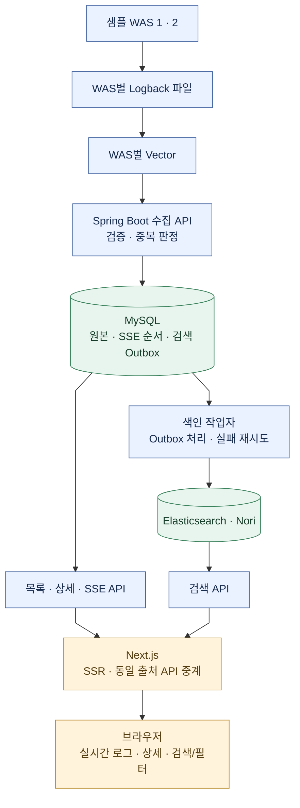

# logscope

### 여러 서버에 흩어진 로그를 한곳에서, 발생한 순간부터 원인 확인까지

이커머스 운영 환경에서 겪었던 로그 추적의 불편함을 바탕으로 만든 **중앙 로그 수집·실시간 조회 플랫폼**입니다.

여러 WAS에서 발생한 로그를 모아 발생 서버와 오류 원문을 확인하고, 저장된 로그를 검색할 수 있도록 구성했습니다.

**중앙 로그 수집 · SSE 실시간 조회 · Elasticsearch 한국어 검색**

## 개발 배경

여러 WAS로 서비스하는 이커머스 환경에서는 오류가 발생해도 어느 서버에 로그가 남았는지부터 확인해야 했습니다.

- 동일 서비스를 제공하는 WAS마다 로그가 따로 쌓입니다.
- 많은 로그 사이에서 발생 시각과 서버를 대조해야 합니다.
- 오류 메시지와 stack trace를 확인하기 위해 서버별로 반복해서 접근해야 합니다.

> 서버별 로그를 중앙에 모으고, 발생한 서버와 오류 내용을 같은 화면에서 확인하는 것이 첫 번째 목표입니다.

## 주요 기능

| 기능 | 내용 | 상태 |
| --- | --- | --- |
| 중앙 로그 수집 | WAS별 파일 로그를 Vector로 수집하고 배치 API로 저장 | 구현 |
| 이커머스 샘플 WAS | 두 WAS에서 업무 시나리오 기반 자동·수동 로그 생성 | 구현 |
| 실시간 로그 조회 | SSE로 새 로그 표시, 일시정지·재개·재연결 | 구현 |
| 로그 상세 | 서버·서비스·메시지 원문·stack trace 확인과 복사 | 구현 |
| 메시지 검색 API | 기간·서버·레벨 필터와 Elasticsearch Nori 검색 | 구현 |
| 검색 화면 | 실시간·검색 모드 분리, 기간·서버·레벨·메시지 검색 | 구현 |
| 과거 로그 페이지 탐색 | 최신 결과 이후의 이력 탐색 | 후속 |
| 트래픽·지표 비교 | 로그와 지표를 함께 보는 관측 기능 | 향후 확장 |

현재 실시간 화면은 **최근 24시간 중 최신 50건**을 표시합니다. 전체 로그 이력을 화면에 보관하는 방식은 아닙니다.

## 화면

실시간 로그 목록·상세 화면과 일시정지·재개 동작 영상, 샘플 WAS 로그 생성 화면은 실제 구현을 기준으로 추후 추가합니다. 아래 로컬 실행 절차로 현재 화면을 확인할 수 있습니다.

## 시스템 구성

<div align="center">



</div>

MySQL을 중심으로 **실시간 조회 경로**와 **검색 색인 경로**가 나뉘고, Next.js를 통해 하나의 화면으로 연결됩니다. 화살표는 데이터 전달·응답 방향을 표현하며 조회 요청은 화면에서 서버로 보냅니다.

### 데이터가 화면에 도착하는 과정

1. WAS가 합성 로그를 Logback JSON 파일에 기록합니다.
2. WAS별 Vector가 파일을 읽어 배치 수집 API로 전송합니다.
3. 백엔드가 로그를 검증하고 MySQL에 저장합니다.
4. 최초 화면은 SSR로 목록과 연결 기준점을 함께 받습니다.
5. 이후 저장된 로그는 SSE로 전달되어 새로고침 없이 표시됩니다.
6. 별도 작업자가 Elasticsearch에 색인하면 검색 보기에서 기간·서버·레벨·메시지로 조회할 수 있습니다.

검색 보기로 전환하면 SSE 연결을 중단하고 조회 버튼 또는 Enter로 조건을 적용합니다. 검색 결과는 고정 목록이며 실시간 로그를 검색 결과에 자동 합치지 않습니다. 실시간 보기로 돌아가면 새 snapshot으로 연결합니다.

**MySQL 저장·실시간 전달과 검색 색인 반영은 서로 다른 단계입니다.** 실시간 화면에서 확인한 로그가 검색에는 조금 늦게 나타날 수 있습니다.

## 핵심 설계와 선택 이유

### 원본 저장과 검색을 분리

MySQL을 로그 원본으로 유지하고 Elasticsearch에는 검색에 필요한 데이터를 색인합니다. 원본 조회와 상세는 MySQL, 메시지 검색은 Elasticsearch·Nori를 사용합니다. Elasticsearch 장애가 로그 수집과 SSE를 함께 중단시키지 않도록 분리했습니다.

검색은 단순 문자열 포함 여부가 아니라 **메시지 분석 결과를 바탕으로 하는 AND 검색**입니다.

### 저장과 색인 작업을 같은 트랜잭션으로 기록

로그 원본, SSE 저장 순서, 검색 색인 작업을 MySQL의 같은 트랜잭션에 기록합니다.

```text
로그 저장 + SSE 순서 기록 + 검색 작업 등록
                 ↓
       모두 성공하면 함께 COMMIT
```

원본만 저장되고 검색할 작업이 빠지는 상황을 방지하기 위한 구조입니다. 색인 실패 작업은 Outbox에 남겨 재시도합니다. Elasticsearch 반영과 SSE 전송 자체는 이 DB 트랜잭션 밖에서 수행합니다.

### 재전송을 고려한 중복 처리

Vector가 응답을 받지 못하면 이미 저장된 로그를 다시 보낼 수 있습니다. 로그마다 생성한 eventId를 유지하고 백엔드는 ID와 내용을 비교해 동일 로그의 중복 저장을 막습니다. 같은 ID에 다른 내용이 들어오면 충돌로 처리합니다.

### SSE 연결과 복구 기준을 분리

SSE는 서버에서 화면으로 로그를 전달하는 단방향 통신에 사용합니다. 최초 목록과 같은 DB snapshot의 cursor를 받아 연결하고, 로그 발생 시각과 별개인 **저장 확정 순서**로 이어받습니다.

화면은 정상 처리한 위치만 보관해 재연결·일시정지 후 재개에 사용합니다. 새 로그가 들어와도 선택한 상세·초점·읽던 위치를 유지하도록 처리했습니다.

### 직접 재현하며 조정한 수집 구성

Vector 디스크 버퍼를 검토하는 과정에서 저빈도 로그의 전송 정체를 재현했습니다. 현재 샘플은 메모리 버퍼와 파일 체크포인트·전달 확인을 사용합니다. [선택 과정과 제약](docs/sample-log-pipeline.md#디스크-버퍼-대신-메모리-버퍼를-선택한-이유)을 기록했으며, 모든 장애에서 무손실을 보장하는 구조로 표현하지 않습니다.

## 기술 스택

| 영역 | 기술 |
| --- | --- |
| Backend | Java 25, Spring Boot 4.1.2 |
| Frontend | Next.js, React, TypeScript |
| Database | MySQL 8.4.13 LTS, Flyway |
| Search | Elasticsearch 9.5.5, Nori |
| Collection | Logback, Vector 0.60.0 |
| Realtime | SSE, fetch 기반 스트림 처리 |
| Build | Gradle Wrapper·Kotlin DSL, npm |
| Runtime | Docker, Docker Compose |
| Verification | JUnit, Testcontainers, Playwright, Spotless, Gitleaks, GitHub Actions |

현재 Redis와 Kafka는 도입하지 않았습니다. MySQL 원본·Outbox와 Vector를 중심으로 현재 개발 범위를 구성했습니다.

## 로컬 실행

### 준비

Docker Desktop 또는 Docker Engine과 Compose, Git이 필요합니다. 로컬 전체 검증에는 JDK 25와 프로젝트 지정 Node.js·npm 환경도 필요합니다. 프론트 환경은 [개발·검증 문서](docs/frontend-development.md)를 따릅니다.

```bash
cp .env.example .env
```

.env의 예시 비밀번호를 서로 다른 값으로 변경합니다. 실제 .env는 커밋하지 않습니다. Spring은 .env를 직접 읽지 않으며 Compose가 필요한 변수를 각 서비스에 전달합니다.

### 실행

```bash
docker compose --profile samples up --build -d
```

| 서비스 | 주소 |
| --- | --- |
| logscope | http://localhost:3000 |
| 샘플 WAS 1 | http://localhost:8081 |
| 샘플 WAS 2 | http://localhost:8082 |
| 백엔드 readiness | http://localhost:8080/actuator/health/readiness |
| MySQL | 127.0.0.1:3306 |

Elasticsearch는 Docker 내부 네트워크에서만 접근합니다. 최초 색인 준비가 끝나기 전에는 검색 결과 반영이 지연될 수 있습니다.

### 확인 순서

1. logscope와 샘플 WAS 화면을 엽니다.
2. WAS에서 수동 로그나 예외를 생성합니다.
3. logscope에서 발생 서버와 로그를 확인합니다.
4. 상세에서 메시지·stack trace를 확인합니다.
5. 일시정지 후 로그를 생성하고, 재개했을 때 이어받는지 확인합니다.

### 중지

```bash
docker compose --profile samples stop
```

중지해도 DB·로그·체크포인트 볼륨은 유지됩니다.

## 검증

```bash
git config core.hooksPath .githooks
./scripts/verify.sh
```

공통 검증 스크립트에서 다음 항목을 확인합니다.

- 서버 단위 테스트와 실제 MySQL 통합 테스트
- Flyway migration과 Elasticsearch·Nori 검색 및 복구
- 프론트 타입·lint·포맷·빌드·브라우저 동작
- 실제 API 기반 SSR·상세·SSE 연결과 재연결
- 두 WAS → 파일 → Vector → MySQL 수집 흐름
- 파일 회전·수집기 재시작·재시도
- Docker 이미지·Compose·비밀정보 검사

Docker가 없으면 실제 DB 검사를 생략하는 방식은 사용하지 않습니다.

## 현재 범위와 한계

- 합성 데이터를 사용하는 로컬 개발 환경을 기준으로 검증했습니다.
- 현재 샘플 WAS는 두 대이며 세 대 확장은 후속 범위입니다.
- 실시간 목록은 최신 50건으로 제한합니다.
- Vector의 유한 재시도와 파일 보존 한도로 모든 로그의 무손실 전달을 보장하지 않습니다.
- 검색 색인은 비동기로 반영됩니다.
- 운영 인증·TLS·고가용성·대규모 부하·장기 보존 정책은 별도 설계가 필요합니다.
- 과거 페이지·집계·트래픽·다크 모드는 후속 범위입니다. 검색 결과도 최신 건수 제한과 색인 대기 안내를 사용합니다.

## 상세 문서

| 주제 | 문서 |
| --- | --- |
| 전체 구조 | [아키텍처](docs/architecture.md) |
| 수집 파이프라인 | [샘플 로그 수집](docs/sample-log-pipeline.md) |
| SSE API | [실시간 조회 명세](docs/contracts/log-sse.md) |
| 실시간 화면 | [프론트 실시간 로그 탐색](docs/frontend-live-view.md) |
| 검색 API | [로그 검색 명세](docs/contracts/log-search.md) |
| 검색 화면 | [프론트 검색 보기](docs/frontend-search-view.md) |
| 검색 설계 이유 | [Elasticsearch 설계 결정](docs/decisions/elasticsearch-log-search.md) |
| 개발 과정과 학습 | [영역별 학습 기록](docs/learning/) |
| 운영·복구 | [운영 절차](docs/operations.md) |
| 공통 작업 규칙 | [AGENTS.md](AGENTS.md) |
| 초기 README | [기존 문서 원본](old_readme.md) |
