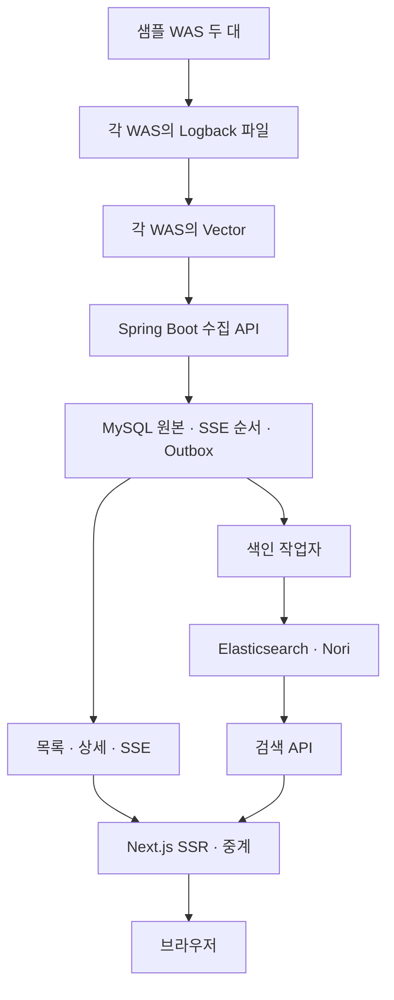

# 현재 구현과 전체 흐름

2026-11-03 원격 main의 README 병합까지 반영한 문서 점검 기준이다. 애플리케이션을 새로 실행하거나 실제 로컬 DB에 migration을 적용한 결과는 아니다. 서버 이미지·실제 DB는 최신 코드와 적용 시점이 다를 수 있다.

## 완료된 사용자 흐름

- 두 샘플 WAS에서 이커머스 합성 로그를 수동으로 만들거나 30초마다 자동 생성한다.
- WAS별 Vector가 파일을 읽어 배치 API로 전송하고 MySQL에 저장한다. 재전송은 eventId와 내용으로 중복·충돌을 구분한다.
- 브라우저 첫 화면은 서버에서 목록과 cursor를 받고, 이후 SSE로 최신 로그를 이어받는다. 일시정지·재개·재연결·상세·원문 복사를 지원한다.
- 검색 보기에서 기간·서버·레벨·메시지로 검색한다. 메시지는 Nori 분석 AND 검색이고 단순 부분 문자열이나 stack trace 검색이 아니다.
- 검색은 ES, 상세와 실시간 replay는 MySQL을 사용한다. 검색 보기에서는 SSE를 닫고 조회 버튼/Enter로 검색한다. 실시간 복귀 시 새 snapshot으로 시작한다.

## 분야별 구현

| 분야 | 현재 구현 | 이유를 읽을 위치 |
| --- | --- | --- |
| 백엔드 | 단건/배치 수집·중복·MySQL 저장·상세·SSE·검색·Outbox 동기화 | 기능별 collection/storage/realtime/search |
| 프론트 | SSR·실시간/검색 모드·조건 입력·오류 보존·정지/재개·상세/복사/초점 | [화면 안내](features/frontend/README.md) |
| 디자인 | 밝은 테마·공통 헤더/사이드바·목록/비모달 상세·좁은 화면 배치 | [화면 안내](features/frontend/README.md) |
| 인프라 | Compose·이미지·실제 DB/ES/브라우저/수집 통합 검사·CI·비밀 검사 | [실행·검증](features/runtime/README.md) |

## 저장소 역할

MySQL의 log_events는 로그 원본, log_stream_state는 SSE 복구 상태, log_search_outbox는 색인할 작업, log_search_state는 색인 상태다. 로그 원본·저장 순서·Outbox 등록은 한 트랜잭션이다. 실제 ES 요청과 브라우저 전달을 이 트랜잭션 안에서 동시에 실행하는 것은 아니다. Flyway가 DB 변경 이력을 관리한다.

Elasticsearch는 검색용 사본이다. 저장보다 검색 반영이 늦을 수 있고 장애 시 색인 작업을 DB에 남겨 재시도한다. ES 장애를 빈 검색 결과로 바꾸지 않는다. ES가 항상 빠르다는 성능 측정 결과를 주장하지 않는다.

## 현재 한계

최신 24시간/50건의 실시간 보기와 최신 건수 제한의 검색을 제공하며 과거 페이지 탐색은 없다. 서버 선택지 상수에 was-3가 있어도 실행 샘플은 두 대다. 새 로그 안내/목록 움직임 개선, 동적 서버 목록, 세 WAS 확장, 집계·트래픽·다크 모드는 후속이다. 로컬 합성 환경의 기능 검증과 운영 배포·부하·보안 준비를 구분한다. 모든 장애의 무손실·전체 이력 복구를 보장하지 않는다.

[다음 계획](next-steps.md) · [문서 안내](README.md)
